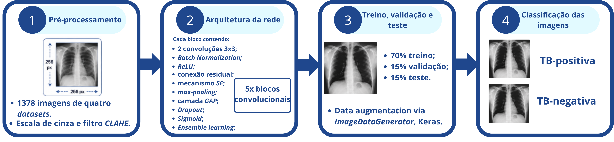
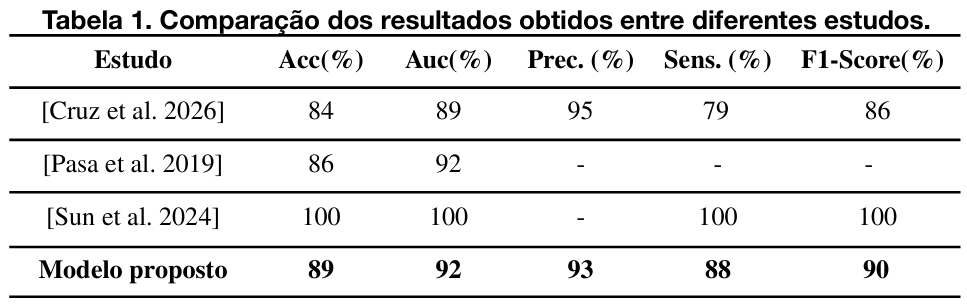
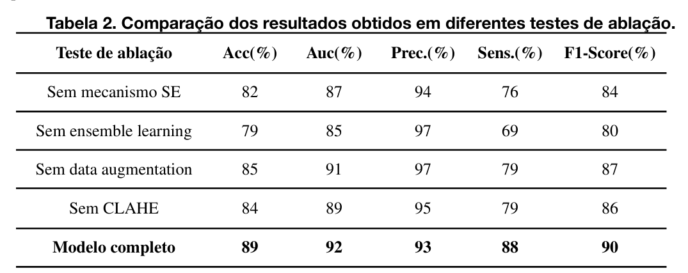

<h1 align="center">
TB x-rAI Net 2.0: Evolução no Apoio ao Diagnóstico de Tuberculose em Imagens Radiológicas através de Rede Neural Convolucional
</h1>

Este repositório apresenta um modelo de Rede Neural Convolucional desenvolvido para o apoio ao diagnóstico da Tuberculose (TB) a partir de imagens radiológicas. O objetivo deste estudo é desenvolver um método que seja capaz de oferecer apoio aos profissionais da área da saúde a tomarem decisões com maior rapidez e precisão. Cabe ressaltar que a TB x-rAI Net 2.0 não substitui o diagnóstico médico.

O treinamento do modelo foi realizado no ambiente do <em>Google Colab</em> utilizando uma GPU Nvidia T4 Tensor Core a partir de um <em>script</em> em linguagem Python com a utilização das bibliotecas <em>TensorFlow</em>, <em>Keras</em>, <em>NumPy</em>, <em>Matplotlib</em> e <em>Scikit-Learn</em>. 
 

## Base de dados:

Para o desenvolvimento e construção da CNN proposta foram utilizados quatro *datasets* públicos de raio-x torácicos de casos normais e de TB:
- *Belarus Tuberculosis Portal* - [Frapa 2021]
- *DA and DB - TB Chest X-ray Dataset* (Nova Délhi - Índia) - [Chauhan 2014]
- *Montgomery Conty* (EUA) - [Raddar 2020]
- *Shenzhen* (China) - [Mengzhang 2024]

A base de Belarus contém 304 radiografias todas elas TB-positivas; 
A base de Nova Délhi contém 278 radiografias com 138 casos normais e 125 casos de Tuberculose; 
A base de Montgomery contém 138 radiografias com 80 casos normais e 58 TB-positivos; 
A base de Shenzhen contém 662 radiografias com 326 casos normais e 336 casos de Tuberculose.

<strong>Total de imagens : 1382</strong>
 

## Pré-processamento:

Nesta etapa, as imagens passam por uma transformação para uma escala de cinza, são todas redimensionadas para 256x256 <em>pixels</em>. Além disso, a fim de evitar <em>data leakage</em> foram removidas imagens duplicadas, resultando em um total de 1378 imagens, após a remoção de 4 imagens do <em>dataset</em> de Belarus. Ademais, foi aplicado o filtro <em>CLAHE</em>, permitindo melhorar o contraste dos raios-x. 
 

## Arquitetura da rede:

A arquitetura da rede desenvolvida utiliza cinco blocos convolucionais residuais, permitindo que informações vindas das entradas (radiografias) sejam preservadas e combinadas com as características adquiridas ao longo das operações de convolução. Em cada um dos blocos são aplicadas duas convoluções 3x3, seguidas de um <em>BatchNormalization</em>, função de ativação ReLU, mecanismo de atenção <em>Squeeze-and-Excitation</em> (<em>SE</em>), para a definição da importância dos canais da rede e recalibração desses canais. Além disso, é utilizada uma operação de <em>Max Pooling</em>, na redução do custo computacional da CNN, diminuição espacial e na preservação de ativações mais elevadas, uma camada <em>GAP</em> (<em>Global Average Pooling</em>), realizando o cálculo da média dos valores dos canais, obtidos anteriormente no <em>Max Pooling</em>. Ao fim, o método aplica <em>dropout</em> para reduzir o <em>overfitting</em> e utiliza uma camada totalmente conectada com uma ativação <em>Sigmoid</em>, para a geração binária das classificações (TB e Saudável). 

O modelo também utiliza três modelos idênticos (<em>ensemble learning</em>) porém com configurações distintas de filtros iniciais e taxas de *dropout*, entre os quais:

- Modelo 1: Filtro de 32 e *dropout* de 0,3;
- Modelo 2: Filtro de 64 e *dropout* de 0,4;
- Modelo 3: Filtro de 128 e *dropout* de 0,5.

  
   
  <strong>Figura 1</strong>: Arquitetura da CNN proposta.

 

## Divisão dos dados de treinamento, validação e teste

A estratégia de divisão definida utilizou uma proporção de <strong>70% das imagens para treino, 15% para validação e 15% para teste</strong>. Antes de realizar a separação da base dos dados ocorre uma identificação a nível de paciente para cada uma das radiografias usadas no modelo e remoção de imagens duplicadas. Isso permitiu evitar que uma mesma radiografia de um determinado paciente aparecesse de maneira simultânea em mais de um conjunto.

Na etapa de <strong>treino</strong>, são definidos lotes contendo 16 imagens e essas são embaralhadas a cada época, de forma que a rede nunca receba a mesma sequência. Ademais, é aplicado aumento de dados (<em>data augmentation</em>) por meio do *ImageDataGenerator* da biblioteca <em>Keras</em>. As transformações aplicadas nas radiografias envolvem: 

- Rotações;
- Deslocamentos verticais e horizontais;
- Zoom;
- Alterações no brilho;
- Espelhamento horizontal;
- Cisalhamento.

Cabe ressaltar que a técnica de <em>data augmentation</em> é aplicada somente aos dados de treinamento da CNN.
Os três modelos do <em>ensemble learning</em> foram treinados por até 50 épocas, em momentos que o método não apresentava melhora, o treinamento do modelo encerrava. Isso foi definido por meio do <em>Early Stopping</em>, como uma outra estratégia para o combate ao <em>overfitting</em>. O otimizador <em>Adam</em> também foi aplicado com uma taxa de aprendizado de 10-4 e o <em>Reduce LR On Plateau</em>.

Já na etapa de <strong>validação</strong> as métricas da AUC, acurácia, sensibilidade, precisão e função de perda foram avaliadas. As probabilidades da função de ativação <em>Sigmoid</em> foram utilizadas para o cálculo da AUC. Essas probabilidades definiram os pesos a serem aplicados a cada um dos modelos de <em>ensemble</em>. O <em>threshold</em> de classificação foi estabelecido por meio do Índice de Youden na curva ROC e métrica da sensibilidade.

Por fim, na etapa de <strong>teste</strong>, o <em>threshold</em> definiu a classificação final de cada imagem e os pesos do <em>ensemble</em> foram combinados por meio de uma média ponderada.

  
   
  <strong>Figura 2</strong>: Resumo do funcionamento da TB x-rAI Net 2.0.

 

## Resultados experimentais

A tabela 1, apresentada abaixo, demonstra o desempenho da TB x-rAI Net 2.0, comparando-a com outros modelos como [Pasa et al. 2019], [Sun et al. 2024] e com o método inicial, o TB x-rAI [Cruz et al. 2026]. Destaca-se que os primeiros estudos apresentam semelhanças com a CNN desenvolvida, porém com algumas ressalvas ao contexto experimental, sendo necessária uma análise cautelosa. 

Ao comparar com [Cruz et al. 2026] os resultados obtidos para o novo modelo demonstraram seu potencial para a identificação da Tuberculose, na qual a adição de novas técnicas como o filtro <em>CLAHE</em> pode melhorar as métricas encontradas. 

  

 

Na identificação do papel de cada uma das técnicas utilizadas realizou-se um estudo de ablação removendo, isoladamente, cada um dos mecanismos. Os resultados encontrados estão presentes na tabela abaixo:

  

 

 De acordo com o estudo de ablação, nota-se que a remoção individual de cada técnica reduziu o desempenho do modelo completo. Cabe destacar o impacto referente a remoção do <em>ensemble learning</em>, mecanismo <em>SE</em> e <em>CLAHE</em>, o qual diminuiu a acurácia e a sensibilidade. Embora a retirada das estratégias citadas tenham exibido uma precisão superior ao modelo completo, o uso combinado dessas elevou os valores encontrados nas demais medidas.

Para trabalhos futuros propõe-se realizar a validação da TB x-rAI Net 2.0 com profissionais da área de saúde, adicionar uma base de dados local, proveniente do Hospital HU da FURG e seguir melhorando o modelo.
 

## Extra:

 Com o objetivo de facilitar a utilização do modelo por profissionais especializados da saúde definiu-se a necessidade de criar uma interface <em>web</em> intuitiva e amigável, o qual permitisse o <em>upload</em> da radiografia a ser analisada e gerado um resultado, com base na inferência da TB x-rAI Net 2.0.

Com base nisso, o <site> foi desenvolvido utilizando no <em>frontend</em> o <em>JavaScript</em>, HTML e <em>Tailwind CSS</em> para a geração de um <em>layout</em> responsivo e estilizado. Para a integração com a CNN utilizou-se o <em>microframework Flask</em> do Python, permitindo a obtenção de resultados em tempo real.

 A ferramenta possui três telas principais, como demonstrado nas figuras logo abaixo: 

- Tela de início com as principais informações;
- Tela de *upload*;
- Tela de resultados.

 Conforme ilustrado na figura 1, a página inicial apresenta aos usuários um menu interativo que permite uma navegação facilitada, juntamente com um panorama geral das funcionalidades e propósito da ferramenta, seguido da documentação do modelo, da referência à CNN base e de exemplos de <em>datasets</em> com imagens públicas de TB.  
  
Para realizar o <em>upload</em> das radiografias (figura 2), o usuário é redirecionado a uma tela exclusiva para esse fim, mostrando quais são os formatos permitidos de imagens. Destaca-se que a definição do <em>upload</em> de uma única imagem possibilitou a análise rápida do modelo, gerando os resultados em poucos segundos de espera, tornando-se um apoio a decisões rápidas e mais assertivas para médicos e profissionais da saúde, mas de forma a não substituir a análise clínica. Além disso, a definição do <em>upload</em> de uma única radiografia também foi pensada na usabilidade de um profissional da área.

Por fim, na página de resultados são demonstradas as análises para a imagem selecionada, bem como gerado um <em>grad-CAM</em>, mapa de calor que auxilia no entendimento das decisões da CNN.

É importante ressaltar que a ferramenta encontra-se em fase de desenvolvimento, ainda não publicada de forma <em>online</em>. As etapas futuras de construção envolvem a adição de novas funcionalidades como o cadastro do usuário e histórico de análises.

