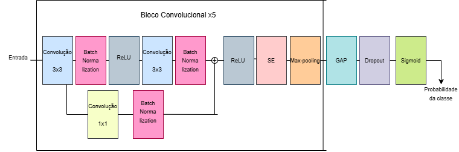

<h1 text-align="center">
TB x-rAI Net 2.0: Evolução no Apoio ao Diagnóstico de Tuberculose em Imagens Radiológicas através de Rede Neural Convolucional
</h1>

Este repositório apresenta um modelo de Rede Neural Convolucional desenvolvido para o apoio ao diagnóstico da Tuberculose (TB) a partir de imagens radiológicas. O objetivo deste estudo é desenvolver um método que seja capaz de oferecer apoio aos profissionais da área da saúde a tomarem decisões com maior rapidez e precisão. Cabe ressaltar que a TB x-rAI Net 2.0 não substitui o diagnóstico médico.

O treinamento do modelo foi realizado no ambiente do *Google Colab* utilizando uma GPU Nvidia T4 Tensor Core a partir de um *script* em linguagem Python com a 
utilização das bibliotecas *TensorFlow*, *Keras*, *NumPy*, *Matplotlib* e *Scikit-Learn*. 

## Base de dados:

Para o desenvolvimento e construção da CNN proposta foram utilizados quatro *datasets* públicos de raio-x torácicos de casos normais e de TB:
- *Belarus Tuberculosis Portal* - [Frapa 2021]
- *DA and DB - TB Chest X-ray Dataset* (Nova Délhi - Índia) - [Chauhan 2014]
- *Montgomery Conty* (EUA) - [Raddar 2020]
- *Shenzhen* (China) - [Mengzhang 2024]

A base de Belarus contém 304 radiografias todas elas TB-positivas;
A base de Nova Délhi contém 278 radiografias com 138 casos normais e 125 casos de Tuberculose;
A base de Montgomery contém 138 radiografias com 80 casos normais e 58 TB-positivos;
A base de Shenzhen contém 662 radiografias com 326 casos normais e 336 casos de Tuberculose.

**Total de imagens : 1382**

## Pré-processamento:

Nesta etapa, as imagens passam por uma transformação para uma escala de cinza, são todas redimensionadas para 256x256 *pixels*. Além disso, a fim de evitar *data 
leakage* foram removidas imagens duplicadas, resultando em um **total de 1378 imagens**, após a remoção de 4 imagens do *dataset* de Belarus. Ademais, foi 
aplicado o filtro *CLAHE*, permitindo melhorar o contraste dos raios-x. 

## Arquitetura da rede:

A arquitetura da rede desenvolvida utiliza cinco blocos convolucionais residuais, permitindo que informações vindas das entradas (radiografias) sejam preservadas e combinadas com as características adquiridas ao longo das operações de convolução. Em cada um dos blocos são aplicadas duas convoluções 3x3, seguidas de um *BatchNormalization* de tamanho 16, função de ativação ReLU, mecanismo de atenção *Squeeze-and-Excitation* (SE), para a definição da importância dos canais da rede e recalibração desses canais. Além disso, é utilizada uma operação de *Max Pooling*, na redução do custo computacional da CNN, diminuição espacial e na preservação de ativações mais elevadas, uma camada *GAP* (*Global Average Pooling*), realizando o cálculo da média dos valores dos canais, obtidos anteriormente no *Max Pooling*. Ao fim, o método aplica *dropout* para reduzir o *overfitting* e utiliza uma camada totalmente conectada com uma ativação *Sigmoid*, para a geração binária das classificações (TB e Saudável). 

O modelo também utiliza três modelos idênticos porém com configurações distintas de filtros iniciais e taxas de *dropout*, entre os quais:

- Modelo 1: Filtro de 32 e *dropout* de 0,3;
- Modelo 2: Filtro de 64 e *dropout* de 0,4;
- Modelo 3: Filtro de 128 e *dropout* de 0,5.

**Figura 1**: Arquitetura da TB x-rAI Net 2.0. 

